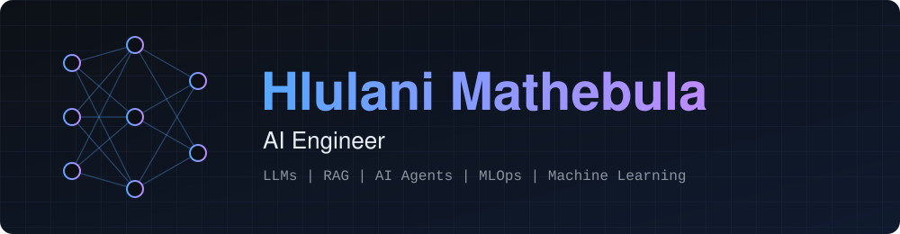
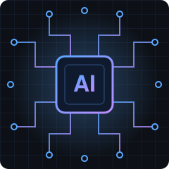

  

  
  

---

## About

<table>
  <tr>
    <td width="240" align="center"></td>
    <td>
      AI Engineer building AI agents, knowledge-retrieval systems and automated data pipelines on Azure and Microsoft 365.  
      My work began with business automation on Power Automate, Power Apps and SharePoint, alongside Copilot Studio agents. It has grown into AI engineering: agents grounded in approved knowledge, retrieval over Azure AI Search, and data pipelines that connect business systems to them.  
      I care most about trust. An AI system in a business should be accurate, accountable and safe to rely on, so I design for that from the first prototype.  
      I work closely with the people who own a process, turning loosely stated rules into precise definitions and then into automated workflows. I also use AI-assisted development tools such as Claude, OpenAI Codex and Microsoft Copilot to move quickly, with tests and independent checks keeping the results reliable.
    </td>
  </tr>
</table>

## What I Do

| 🤖 AI Agents & LLMs | 🔗 Data & Integration | ⚙️ Automation | 🛡️ Governance & Operations |
|---|---|---|---|
| Agent instructions, guardrails and knowledge sources | Scheduled pipelines from business systems | Approval and notification workflows | Read-only by default, with least-privilege access |
| Retrieval and grounded answers with citations | Authentication, pagination, retries and error handling | Digitised forms and processes on Microsoft 365 | Data-protection-aware design and redaction |
| Prompt engineering and evaluation | SQL and data-model queries | Configuration-driven design | Testing, monitoring and data-quality checks |
| Trying new model capabilities against real use cases | Reconciling outputs against source systems | From prototype to dependable solution | Handover documentation and user enablement |

## Tech Stack

**AI & Agents** 
`Azure OpenAI` `Microsoft Foundry` `Copilot Studio` `Azure AI Search` `Azure AI Language` `LLMs` `Prompt Engineering` `AI Guardrails` `Knowledge Retrieval`

**Cloud & Microsoft 365** 
`Microsoft Azure` `Azure Storage` `Google BigQuery` `SharePoint` `Microsoft Teams` `Microsoft 365`

**Automation** 
`Power Automate` `Power Apps` `Microsoft Forms` `Event-driven Workflows`

**Data & Integration** 
`SQL` `REST APIs` `Data Pipelines` `CRM Integration` `Project-management Integration`

**Languages & Tools** 
`Python` `JavaScript` `Node.js` `PowerShell` `Git` `Replit` `Claude` `OpenAI Codex` `Microsoft Copilot`

## Selected Work

Prototypes built on fictional data. Code is available on request.

### Reliable API Integration
A read-only integration pattern that keeps working when the source API does not, tested against a mock API that fails on purpose.

- Authentication with token refresh, cursor pagination, and retries with backoff that obey rate limits
- Read-only by default: writes are refused unless explicitly approved
- Invalid records are quarantined, loading is atomic, and every run is reconciled against the source
- Evaluated across 40 randomised failure schedules, with an operations runbook for handover

`REST APIs` `Python` `Reliability` `Data Quality`

### Grounded Business Agents
Agents that answer from approved knowledge only, and decline when the evidence is missing.

- Retrieval over approved knowledge, with responses checked against it before they are returned
- Guardrails that redact personal data and refuse out-of-scope requests
- An evaluation set and automated tests that run on every change, with known limits reported openly
- Optional hosted-model support behind the same guardrails, with credentials read only from the environment

`AI Agents` `Azure OpenAI` `Python` `Evaluation`

## Connect

Open to AI engineering roles and collaboration. Reach me on [LinkedIn](https://www.linkedin.com/in/hlulanimathebula).
